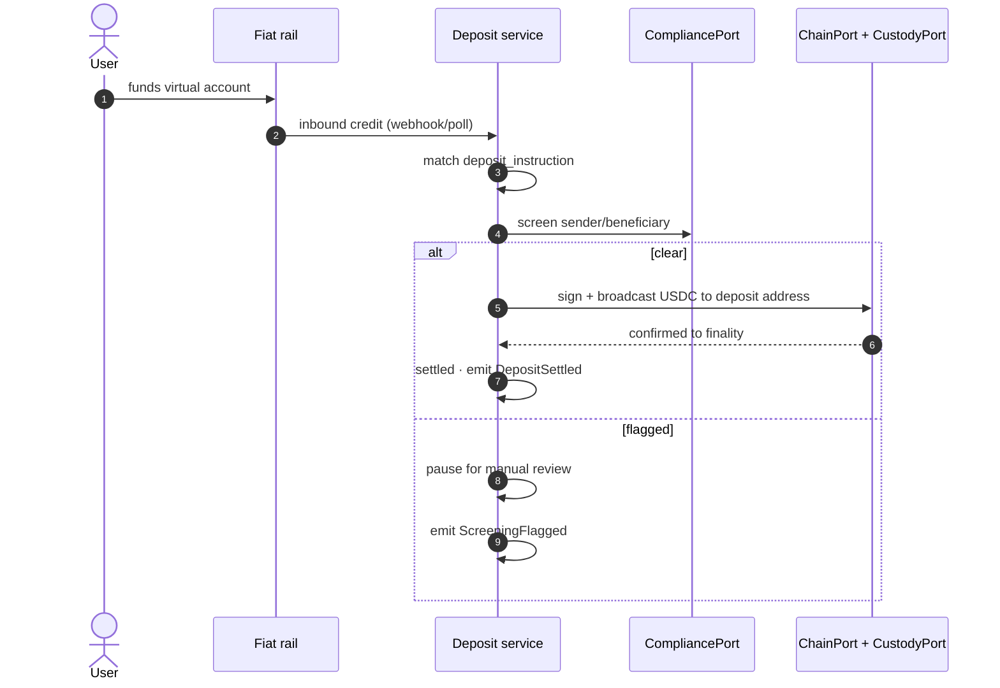
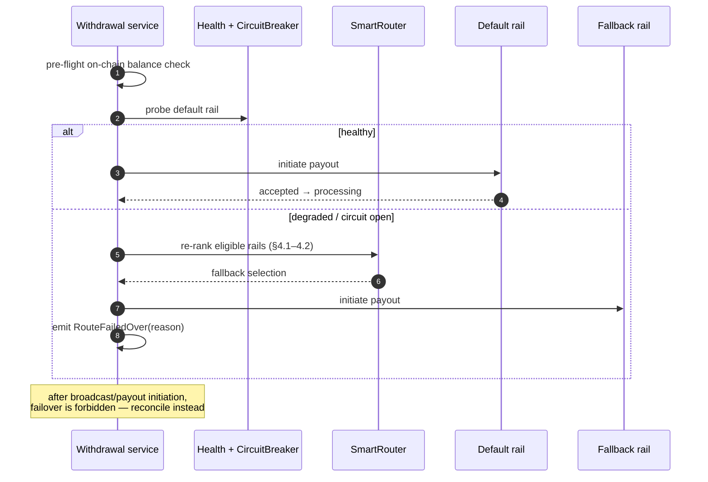
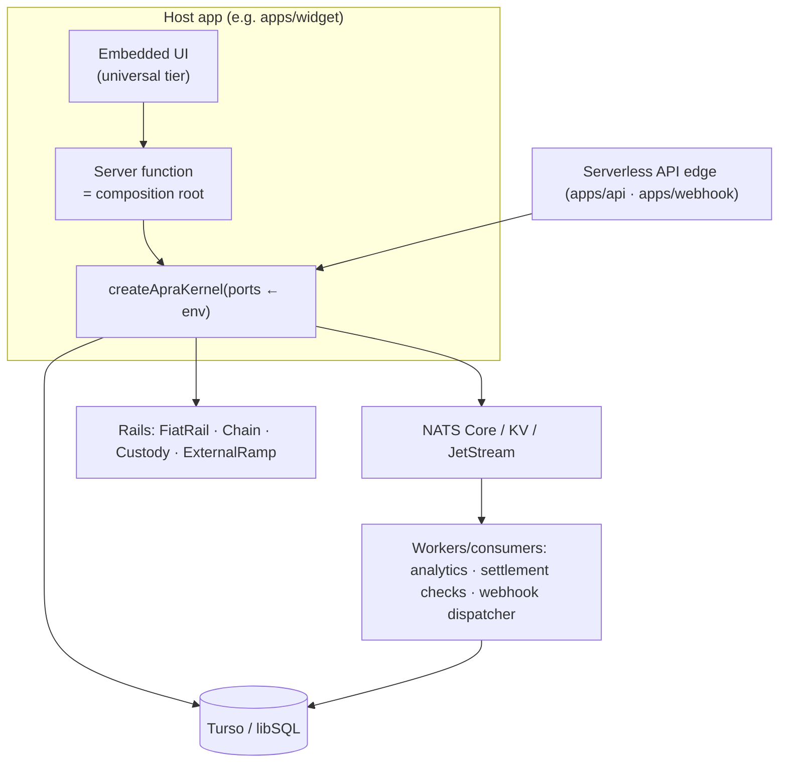

# Embedded Crypto Payments Platform — Deposits, Withdrawals, Checkout on Blockchain Rails

## 1. Objective

Build a TypeScript platform that merchants and fintechs embed to accept and move money on blockchain rails. The platform owns rails and custody; the **public blockchain is the system of record** for balances and transfers — there is no private double-entry ledger. Blockchain complexity is hidden from merchant end-users.

Three products:

- **Deposits** — fiat → stablecoin. User funds a per-user virtual account; platform screens, then delivers USDC/USDT straight into the user's deposit address on the default chain. Balance lives on-chain.
- **Withdrawals** — wallet debit → fiat payout or on-chain transfer. Pre-flight on-chain balance check, screen, then pay out via fiat rail or broadcast on-chain.
- **Checkout** — session-based funding embedded in a dApp. Payment options are fiat methods ∪ crypto transfer ("Transfer Crypto" mode: external wallet/exchange source → dApp destination).

External ramps (MoonPay, Transak, Ramp, YellowCard) become one optional rail type behind `ExternalRampPort`, not the product headline.

The package name `@baggit/apra` is unchanged for now; the architecture below supersedes ramp-aggregation-as-product.

---

## 2. Product Requirements

### 2.1 Merchant API & Auth

- API keys with `test` / `live` separation.
- Versioned REST under `/v1`.
- Idempotency keys required on all mutating endpoints.
- Request IDs propagated end-to-end into events and logs.
- End-user authentication is delegated to the embedding application: core consumes identity only through `AuthPort`. Reference implementation lives at the app layer: better-auth with Drizzle-persisted sessions, read-through cached in NATS KV (DB authoritative; revocation invalidates the cache entry synchronously).

### 2.2 On-Chain Wallet Model

- Every customer gets deterministic per-chain deposit addresses (Base + Solana initially); key material derives from the KMS root and exists only behind `CustodyPort`.
- The public chain is the system of record: balances, transfer history, and finality are read via `ChainPort` (RPC/indexer) and cached read-through in NATS KV with a short TTL. The platform never stores authoritative balances.
- Platform movements are single stablecoin transfers to/from custodial wallets; the chain's immutable history is the audit trail for crypto legs. Fiat-side legs keep durable local lifecycle rows plus reconciliation.
- Concurrency: broadcasts from one custodial wallet serialize under a distributed lock keyed by address — two simultaneous debits cannot both pass pre-flight.
- Per-chain confirmation policies guard against reorgs before a transfer counts as settled.
- **Money representation:** fiat = integer minor units + ISO-4217 code (quotes, virtual-account instructions); crypto = decimal string of atomic units + asset decimals metadata. Floating-point amounts prohibited everywhere (see §6d).

### 2.3 Deposits

Per-user fiat virtual-account instructions issued by fiat-rail adapters.

```text
user funds virtual account
  → inbound credit detected (webhook/poll)
  → match to deposit instruction
  → sanctions screening
  → stablecoin delivered to user's deposit address (CustodyPort-signed broadcast)
  → confirmations tracked to finality
```

Explicit status lifecycle: `initiated → funds_detected → screened → delivered → settled` (`settled` = confirmed to finality), with `failed` reachable from any state.



### 2.4 Withdrawals

```text
withdrawal requested
  → pre-flight: on-chain balance + confirmation check on source wallet
  → sanctions screening
  → payout via fiat rail OR on-chain transfer
  → broadcast/payout confirmed; lifecycle row closed
```

- Destination address allowlist with a cooling period before first payout.
- Per-user velocity and amount limits.
- Source of funds is the user's custodial deposit wallet; batched treasury sweeps keep it gas-funded.
- Explicit status lifecycle mirroring deposits (`initiated → screening → processing → settled / failed`).

### 2.5 Checkout

- Create-session API returning a session token.
- Hosted UI contract (redirect) + embedded UI contract (in-page component).
- Payment options = fiat methods ∪ crypto transfer.
- Quote locked to session TTL; expiry enforced server-side.
- Completion emits a webhook and redirects/completes the embedded flow.
- **Transfer Crypto mode:** external wallet or exchange as source, dApp destination address as target; platform tracks inbound chain transfer to completion.

```mermaid
sequenceDiagram
    autonumber
    participant M as Merchant dApp
    participant CA as Checkout API
    participant QR as Quote + routing
    actor U as End user
    participant WD as Webhook dispatcher

    M->>CA: POST /v1/checkout/sessions
    CA->>QR: lock quote (fiat ∪ crypto options)
    CA-->>M: session_token + TTL
    U->>CA: choose payment option (session-token authed)
    alt fiat method
        CA-->>U: virtual-account / method instructions
        U->>CA: pays via method; inbound credit tracked
    else transfer crypto
        CA-->>U: destination address + exact amount + expiry
        U->>CA: broadcasts from external wallet/exchange
        CA->>CA: await confirmation (ChainPort)
    end
    CA->>WD: CheckoutCompleted · HMAC-signed webhook
    CA-->>M: redirect / embedded completion callback
```

### 2.6 Outbound Webhooks

- HMAC-SHA256 signatures on every delivery.
- Enumerated event catalog (see §5).
- Exponential-backoff retries with dead-letter termination.
- Endpoint management API (register, rotate secret, disable).
- Delivery log table recording attempts, responses, and final disposition.

### 2.7 Compliance

- KYC/KYB through a `CompliancePort` backed by external vendors.
- Sanctions screening is a hard gate: no chain broadcast or fiat payout without a passed screen.
- Velocity rules enforced before any payout executes.
- Immutable audit trail of all compliance decisions.
- Travel-rule messaging is out of scope for this revision.

---

## 3. Rail Abstraction

Rails are pluggable behind ports. Adding a rail = 1 adapter + registry registration, 0 core changes.

| Port | Responsibility |
|---|---|
| `FiatRailPort` | Virtual accounts, inbound credit webhooks/polling, fiat payouts |
| `ChainPort` | Address derivation, transfer build, confirmation tracking, fee estimation |
| `CustodyPort` | Key custody via KMS/HSM adapter, hot-wallet management, treasury sweeps |
| `ExternalRampPort` | Third-party ramps (optional); existing MoonPay/Transak/Ramp/YellowCard adapters live here |

Broadcasts execute only through `CustodyPort`.

Initial chains: Base (EVM L2) + Solana. Settlement assets: USDC primary, USDT secondary.

---

## 4. Routing, Ranking & Rail Failover

### 4.1 Eligibility filter

Before scoring, rails are filtered by corridor support (geography × fiat × asset × method), KYC-tier compatibility, limit headroom, and circuit-breaker state. Ineligible rails never enter ranking.

### 4.2 Composite ranking score (deterministic)

```text
score = wr·R + wf·F + ws·S + wl·L + wu·U
```

| Factor | Definition |
|---|---|
| `R` reliability | Success rate shrunk to a Wilson / Beta posterior **lower bound** (95%) so low-volume providers cannot rank on tiny samples |
| `F` economics | Fee-adjusted net rate delivered to merchant/end-user (higher is better) |
| `S` speed | EWMA over log settlement latency; p95 enters as a tail penalty |
| `L` liquidity | Quote depth ÷ requested amount |
| `U` availability | Health-probe EWMA; open circuit ⇒ factor 0 |

Weights configurable per product: checkout weights `S` highest; payouts weight `F`.

### 4.3 Exploration — Thompson sampling

Deterministic scores rank; a Thompson-sampling bandit allocates marginal traffic among near-ties (scores within ε): each rail keeps a Beta(success, failure) posterior sampled once per transaction. Optimistic priors solve cold start; losers converge out automatically. The bandit never overrides a strict score leader beyond the exploration budget.

### 4.4 Default rails + smart failover (deposits & withdrawals)

Merchants configure a default rail per corridor. Health probes and per-rail circuit breakers watch it continuously:

- Default healthy → all traffic to the default rail (no bandit noise on the money path).
- Default degraded/open → `SmartRouter` re-runs §4.1–4.2 over remaining eligible rails and fails over; `RouteFailedOver` emitted with cause.
- Failover is prohibited once funds have left the platform (post-broadcast / post-payout-initiation): recovery is reconciliation, not rerouting.



---

## 5. Events & Analytics

Extend `EVENT_TYPES` in `src/domain/events/events.ts` with:

- `Deposit*` lifecycle events (matching §2.3 states)
- `Withdrawal*` lifecycle events (matching §2.4 states)
- `Checkout*` lifecycle events (session created/expired/completed)
- `DepositDelivered`, `WithdrawalBroadcast`, `WithdrawalConfirmed`
- `ScreeningFlagged`
- `WebhookDelivered`, `WebhookFailed`

The analytics pipeline (`analytics-consumer`) keeps its current shape: JetStream consumer → persist → cache metrics. All payload amounts typed per the money rule in §2.2 / §6d.

---

## 6. Statelessness & Correctness Mandates

These four are normative. Each fixes a defect present in current code.

**(a) No module-level singletons in library code.** Bus/cache handles are injected. `setEventBus()` in `src/primitives/emit.ts` is deleted; callers construct an emitter with an injected `EventBusPort`.

**(b) No in-process timers.** The `SettlementTracker` polling map (`setInterval` entries in a process-local `Map`, `src/application/settlement/settlement-tracker.ts`) is replaced by durable queue-driven check tasks (JetStream work group). Any instance may crash and another resumes the work.

**(c) Distributed-lock idempotency.** `withIdempotency` must take the distributed lock before its check-then-set. The current unlocked sequence races under concurrent duplicate requests.

**(d) Money representation.**
- Fiat: integer minor units + ISO-4217 code.
- Crypto: decimal string of atomic units + asset decimals metadata.
- Zod schemas and Drizzle columns updated accordingly during implementation phases. No float money anywhere.

**(e) Tiered isomorphic exports.** Every public entry point declares an execution tier: `universal` (safe in browser, worker, and server — domain, money types, DTOs/Zod contracts, pure primitives) or `server-only` (wallet orchestration, custody, compliance orchestration, infrastructure adapters). Universal code uses standards-only APIs (fetch, WebCrypto-compatible), no Node globals, no secret material; server-only entries are import-guarded per §12 so accidental client bundling fails the build rather than shipping privileged code.

---

## 7. Data Model

Keep the existing 7 tables. Add:

| Table | Purpose |
|---|---|
| `customers` | KYC'd end users |
| `deposit_instructions` | Per-user virtual-account details |
| `addresses` | Per-customer per-chain deposit addresses: chain, derivation index, custody reference, allowlist state |
| `withdrawals` | Withdrawal lifecycle rows |
| `checkout_sessions` | Session tokens, locked quote, TTL |
| `webhook_endpoints` | Merchant webhook registrations |
| `webhook_deliveries` | Delivery attempts and outcomes |
| `screening_results` | Compliance gate outcomes |
| `reconciliation_runs` | Scheduled reconciliation executions |
| `reconciliation_breaks` | Detected mismatches |

All monetary columns follow §6d. Drizzle migrations required for every schema change.

---

## 8. Non-Functional Requirements

### Serverless posture

Must run on Fly Machines, Cloudflare Workers, Vercel Functions, AWS Lambda. Avoid sticky sessions, long-lived memory state, in-process queues, local cron assumptions. Design for stateless execution.

### Deployment topology



API routes and webhooks: serverless. Analytics and settlement consumers: serverless scheduled / queue workers. Cache: NATS KV. Event log: JetStream durable streams. The kernel is constructed per cold start — no process state beyond injected handles.

### SLOs

- Checkout session create p95 < 300 ms warm
- Deposit fiat-credit → stablecoin broadcast p95 < 5 s
- Broadcast batching ≥ 500 TPS aggregate
- Outbound webhook delivery p95 < 30 s
- Broadcast path availability 99.95%

### Reliability

Circuit breaker per rail/provider; graceful degradation.

### Observability

OpenTelemetry hooks, structured logs, trace IDs.

---

## 9. Security

- KMS-backed key custody; no raw key material in application processes.
- No secrets in code or repo.
- PII encrypted at rest.
- Signature verification on all inbound partner webhooks.
- Audit log for admin and API-key operations.
- Least-privilege database roles.

---

## 10. Technology Stack

Unchanged list:

- Language: TypeScript strict mode
- Runtime: Bun-first, standards-compatible fetch APIs
- Database: SQLite (dev) → Turso / libSQL (prod); `better-sqlite3` is dev-only
- Messaging + Cache: NATS (Core + KV + JetStream)
- Validation: Zod
- Testing: Vitest
- Packaging: tsup, ESM-first, CJS compatibility
- Identity/auth: better-auth at the application layer (reference implementation) — Drizzle-persisted, NATS KV-cached sessions; core consumes identity exclusively through `AuthPort`

---

## 11. Architecture & Folder Layout

Hexagonal layers retained; dependencies point inward only (Infrastructure → Adapters → Ports → Application → Domain).

```text
packages/
  core/
    src/
      domain/
        entities/
        value-objects/
        events/
        contracts/

      application/
        routing/
        scoring/
        settlement/
        analytics/
        wallets/           # NEW
        deposits/          # NEW
        withdrawals/       # NEW
        checkout/          # NEW

      ports/
        ProviderPort.ts
        EventBusPort.ts
        CachePort.ts
        DBPort.ts
        FiatRailPort.ts    # NEW
        ChainPort.ts       # NEW
        CustodyPort.ts     # NEW
        WebhookOutPort.ts  # NEW
        CompliancePort.ts  # NEW
        AuthPort.ts       # NEW

      registry/
        ProviderRegistry.ts

      primitives/
        emit.ts
        subscribe.ts
        cache.ts
        lock.ts
        idempotency.ts

      utils/
      kernel/             # NEW: composition root (server-only)
        create-kernel.ts  # createApraKernel(config) factory
        config.ts         # Zod env/config schema

  providers/               # relabeled: external-ramp rails
    moonpay/
    transak/
    ramp/
    yellowcard/

  adapters/
    nats/
    sqlite/
    libsql/
    telemetry/
    chains/
      evm/                 # NEW
      solana/              # NEW
    custody/
      kms/                 # NEW

  sdk/
    src/
      client/
      hooks/
      types/

apps/
  api/
  workers/
  webhook/

configs/
tests/
```

---

## 12. Packaging

Two-tier export map (tsup ESM + CJS). Tier determines where an entry may execute:

| Subpath | Tier | Contents |
|---|---|---|
| `@baggit/apra` (root) | universal | domain entities, money types, DTOs/Zod contracts, scoring math |
| `@baggit/apra/primitives` | universal | handle-injected emit/subscribe/cache/lock/idempotency factories |
| `@baggit/apra/server` | server-only | `createApraKernel`, application services, wallet orchestration, compliance orchestration |
| `@baggit/apra/adapters/*` | server-only | nats, libsql, chains, kms, telemetry |

Enforcement: `exports` conditions (`browser`, `workerd`) exclude `/server` and `/adapters/*`; server entries additionally import the `server-only` guard so accidental client bundling fails the build. Universal tier touches no Node globals and no secrets.

Composition happens at the host application's trust boundary — a server function constructs the kernel from environment-configured ports, then serves UI from it:

```ts
// apps/widget: src/server/apra.ts (server-only)
import { createApraKernel } from "@baggit/apra/server"

export const apra = createApraKernel({
  db: libsqlFromEnv(),
  bus: natsBusFromEnv(),
  cache: natsKvFromEnv(),
  fiatRail, chain, custody, compliance,
})
```

Constructor-injection rule restated and enforced (§6a): no module-level singletons anywhere in library code.

---

## 13. Implementation Order

CI gates every phase: lint → typecheck → unit → contract → integration tests → build.

| Phase | Scope |
|---|---|
| P1 | Money types + ChainPort stub + deterministic address derivation |
| P2 | Rail ports + registry generalization + AuthPort + kernel composition root |
| P3 | Deposits |
| P4 | Withdrawals + custody/KMS |
| P5 | Checkout + outbound webhooks |
| P6 | Compliance + reconciliation |
| P7 | Analytics extension + SDK surface |

Each phase ends with green `vitest run`.

---

## 14. Acceptance Criteria

- A new fiat rail or chain requires adapter + registration only; zero core changes.
- Every balance claim resolvable on-chain: each custodial address's queried balance equals its confirmed transfer history (chain-as-ledger proof test).
- Concurrent duplicate idempotent requests execute exactly once (lock-proven test).
- Webhook receiver rejects unsigned/tampered payloads.
- Library runs statelessly: no `setInterval` and no module-level singletons in `src/` excluding tests.
- Existing unit/contract/integration tests still pass after the money-type migration.
- `createApraKernel()` boots inside a server function of `apps/widget` from injected ports/env and completes a mock deposit end-to-end.
- A client build of the widget excludes every server-only subpath (bundle-composition test fails otherwise).
- Ranking: unit tests pin the Wilson lower-bound behavior and Thompson-sampling convergence; a fault-injection test kills the default rail mid-corridor and asserts reroute with exactly-once broadcast.
